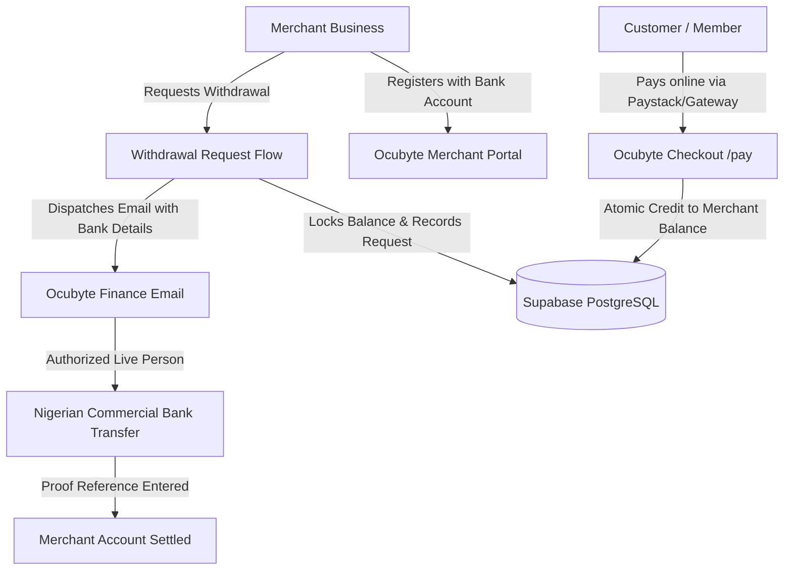

# Ocubyte Remita-Grade Merchant Payment Gateway & Supabase Setup Guide

This guide explains how to connect Ocubyte to **Supabase** and how the **Merchant Registration, Payment Aggregation, and Manual Bank Payouts** operate.

---

## 1. Quick Architecture Overview

Ocubyte acts as an institutional payment gateway aggregator (similar to Remita / Flutterwave):



1. **Merchant Onboarding:** Merchants register their business and provide their verified Nigerian settlement bank account (Access, Zenith, GTBank, Kuda, OPay, Moniepoint, etc.).
2. **Payment Collection:** Customers pay through Ocubyte (`/pay?merchant_code=...`) or via API integration. The net revenue (`Amount - 1.5% fee`) is automatically credited to the merchant's available balance in Supabase.
3. **Manual Human Settlement:** When a merchant initiates a withdrawal, the funds are safely locked in Supabase and an alert email is sent to Ocubyte Finance. A real person logs into online banking, executes the transfer, and records the bank reference.

---

## 2. Step 1: Run the Database Schema in Supabase

1. Open your [Supabase Dashboard](https://supabase.com/dashboard) and select your project.
2. In the left navigation, click on **SQL Editor**.
3. Click **New Query**.
4. Copy and paste the entire contents of [`supabase/schema.sql`](file:///c:/Users/USER/Desktop/Active%20Projects/Ocubyte/supabase/schema.sql) into the query editor.
5. Click **Run** (or `Ctrl + Enter`).

### What this creates:
- `merchants`: Stores business profiles, API keys, bank accounts, and wallet balances.
- `transactions`: Immutable record of all customer payments.
- `withdrawals`: Payout requests with bank details and fulfillment status.
- `audit_logs`: Complete audit trail for financial compliance.
- Atomic Stored Procedures:
  - `credit_merchant_payment()`: Safely credits merchant balance on successful payment.
  - `request_merchant_withdrawal()`: Concurrency-safe balance deduction preventing double-spending.
  - `complete_merchant_withdrawal()`: Marks payout completed with human proof reference.
  - `decline_merchant_withdrawal()`: Reverses deduction if bank details were invalid.

---

## 3. Step 2: Configure Environment Variables

In your project `.env` and Vercel Dashboard (Project Settings $\rightarrow$ Environment Variables), configure:

```env
# Supabase Project Credentials (Found in Project Settings -> API)
VITE_SUPABASE_URL=https://your-project-id.supabase.co
VITE_SUPABASE_ANON_KEY=your_supabase_anon_public_key_here
SUPABASE_URL=https://your-project-id.supabase.co
SUPABASE_ANON_KEY=your_supabase_anon_public_key_here

# Server-Side Service Role Key (Keep strictly confidential, used in API routes)
SUPABASE_SERVICE_ROLE_KEY=your_supabase_service_role_secret_key_here

# Human Settlement Notification (Where withdrawal alerts are sent)
SETTLEMENT_NOTIFICATION_EMAIL=payments@ocubyte.org

# Optional Resend API Key for automated email delivery (https://resend.com)
RESEND_API_KEY=re_your_resend_api_key
```

> [!IMPORTANT]
> The application includes automatic graceful fallback: if Supabase keys are not set yet, it runs in high-fidelity sandbox mode using local storage so you can test registration and withdrawals immediately!

---

## 4. Step 3: Accessing the Merchant Portal

Navigate to:
- **`https://www.ocubyte.org/merchant`** (or `http://localhost:5173/merchant` locally)

Features available:
1. **Financial Overview:** View Available Wallet Balance, Total Volume Processed, Settlement Bank Account, and live Human Payout Desk status.
2. **Withdrawal Request Modal:** Enter amount (with 25%, 50%, 75%, 100% quick buttons), review bank details and ₦50 NIP transfer fee, and submit.
3. **Withdrawals Ledger:** Track requests in real time (`Pending Review`, `Processing`, `Completed`, `Declined`).
4. **Transactions Ledger:** View all customer payments received with fee breakdown and net amounts.
5. **Instant Payment Link Generator:** Create shareable Remita-style payment links (`https://www.ocubyte.org/pay?merchant_code=...&amount=...`) to send to customers on WhatsApp, Email, or SMS.
6. **API Keys & Integration:** Public and Secret API keys with code snippets for embedded checkouts.
7. **Business Registration:** Register new merchants with 10-digit NUBAN account validation across 17 Nigerian banks.

---

## 5. Step 4: The Human Settlement Workflow

When a merchant submits a withdrawal:
1. **Step 1:** The merchant's wallet balance is locked/deducted immediately.
2. **Step 2:** The serverless handler (`/api/merchant/withdraw`) compiles a formatted notification:
   ```text
   REFERENCE:        WTH_20261014_A8B1C2
   BUSINESS NAME:    Apex Logistics Ltd
   DESTINATION BANK: Zenith Bank
   ACCOUNT NUMBER:   1011223344
   ACCOUNT NAME:     Apex Logistics Treasury
   NET PAYOUT DUE:   ₦149,950.00
   ```
3. **Step 3:** The notification is dispatched to `SETTLEMENT_NOTIFICATION_EMAIL` (e.g. `payments@ocubyte.org`).
4. **Step 4:** A human officer at Ocubyte executes the bank transfer from Ocubyte's corporate bank account.
5. **Step 5:** The officer marks the withdrawal completed with the bank session reference in Supabase.
